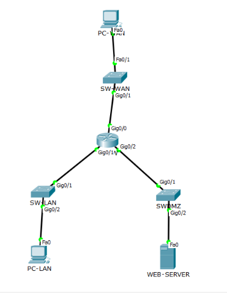

# Исследование сегментации сети и эффективности межсетевой фильтрации

## 1. Введение

Сегментация сети и фильтрация трафика используются для разграничения доступа к сетевым ресурсам. Разделение инфраструктуры на отдельные подсети позволяет выделить зоны с разным назначением, а правила межсетевой фильтрации — контролировать обмен данными между ними. При этом само разделение сети на подсети не гарантирует защищённость. Результат зависит от маршрутизации, настроек фильтрации и порядка обработки правил. Ошибка в конфигурации может привести к разрешению нежелательного трафика или блокировке соединений, которые должны оставаться доступными.

**Цель проекта** — исследовать влияние сегментации сети и правил межсетевой фильтрации на доступность сетевых узлов и сервисов в моделируемой инфраструктуре.

### Задачи проекта

1. Построить модель сети с сегментами WAN, LAN и DMZ.
2. Настроить IP-адресацию и проверить исходную связность узлов.
3. Определить требования к доступу между сетевыми сегментами.
4. Настроить расширенные ACL на маршрутизаторе Cisco 2911.
5. Сравнить результаты сетевых проверок до и после применения фильтрации.
6. Проверить возможность раздельного разрешения и запрета HTTP- и FTP-трафика к одному серверу.
7. Исследовать влияние порядка правил ACL на доступность ресурсов.
8. Проанализировать результаты экспериментов и определить ограничения модели.

## 2. Проектирование сети

### Топология

Модель создана в Cisco Packet Tracer версии 6.1.1. В неё входят маршрутизатор Cisco 2911, три коммутатора Cisco 2960, два пользовательских компьютера и сервер.

Маршрутизатор соединяет три сетевых сегмента:

- **WAN (Wide Area Network)** — внешняя сеть, из которой выполняются проверки доступа к ресурсам.
- **LAN (Local Area Network)** — внутренняя сеть с пользовательским компьютером.
- **DMZ (Demilitarized Zone)** — отдельный сегмент, в котором размещён сервер с HTTP- и FTP-сервисами.

Каждый сегмент подключён к отдельному коммутатору. Маршрутизатор обеспечивает обмен трафиком между подсетями и применяет настроенные правила ACL.

*Топология моделируемой сети в Cisco Packet Tracer (topology.png)*

### IP-адресация

| Устройство | Интерфейс / сегмент | IP-адрес | Шлюз по умолчанию |
|---|---|---|---|
| R1-FW | G0/0, WAN | 203.0.113.1/24 | Не требуется |
| PC-WAN | WAN | 203.0.113.10/24 | 203.0.113.1 |
| R1-FW | G0/1, LAN | 192.168.10.1/24 | Не требуется |
| PC-LAN | LAN | 192.168.10.10/24 | 192.168.10.1 |
| R1-FW | G0/2, DMZ | 192.168.20.1/24 | Не требуется |
| WEB-SERVER | DMZ | 192.168.20.10/24 | 192.168.20.1 |

## 3. Политика доступа

### Рассматриваемые сценарии

В проекте проверяются следующие ситуации:

- попытка доступа из WAN к ресурсам внутренней сети LAN;
- попытка передачи трафика из DMZ в LAN;
- доступ из WAN к HTTP-сервису сервера;
- попытка подключения из WAN к FTP-сервису;
- изменение результата фильтрации при перестановке разрешающего и запрещающего правил ACL.

### Требования к доступу

| Источник | Назначение | Тип трафика | Требуемое действие |
|---|---|---|---|
| WAN | WEB-SERVER (`192.168.20.10`) | HTTP, TCP/80 | Разрешить |
| WAN | WEB-SERVER (`192.168.20.10`) | FTP, TCP/21 | Запретить |
| WAN | LAN (`192.168.10.0/24`) | IP-трафик | Запретить, кроме отдельно разрешённого ICMP echo-reply |
| DMZ (`192.168.20.0/24`) | LAN (`192.168.10.0/24`) | IP-трафик | Запретить |

## 4. Реализация фильтрации

### Список WAN-IN

Список `WAN-IN` применяется к трафику, поступающему из WAN. Согласно итоговому выводу `show access-lists` содержит следующие правила:

| Номер | Правило | Назначение |
|---:|---|---|
| 10 | `permit tcp any host 192.168.20.10 eq www` | Разрешает TCP-трафик к HTTP-порту сервера |
| 15 | `permit icmp any 192.168.10.0 0.0.0.255 echo-reply` | Разрешает ICMP echo-reply с назначением в LAN |
| 20 | `deny ip any 192.168.10.0 0.0.0.255` | Запрещает остальной IP-трафик из WAN в LAN |
| 30 | `permit icmp any 192.168.20.0 0.0.0.255 echo-reply` | Разрешает ICMP echo-reply с назначением в DMZ |
| 50 | `deny tcp any host 192.168.20.10 eq ftp` | Запрещает TCP-трафик к FTP-порту сервера |

ACL проверяет правила сверху вниз и применяет первое совпавшее правило. Поэтому разрешение ICMP echo-reply для LAN расположено перед общим запретом трафика в эту подсеть. Правило HTTP разрешает TCP-трафик к порту 80 сервера. Правило FTP запрещает TCP-трафик к порту 21. Остальной трафик, не совпавший с разрешающими или запрещающими записями, обрабатывается в соответствии с последующими правилами и неявным запретом в конце ACL.

ACL не отслеживает состояние соединений. Для ICMP-пакетов типа `echo-reply` предусмотрено отдельное разрешающее правило. Оно не означает, что маршрутизатор автоматически разрешает ответы на ранее инициированные соединения.

### Список DMZ-IN

Список `DMZ-IN` применяется к трафику, поступающему из DMZ.

| Номер | Правило | Назначение |
|---:|---|---|
| 10 | `deny ip 192.168.20.0 0.0.0.255 192.168.10.0 0.0.0.255` | Запрещает IP-трафик из DMZ в LAN |
| 20 | `permit ip any any` | Разрешает остальной трафик, не совпавший с первым правилом |

Таким образом, трафик из DMZ в LAN блокируется первым правилом. Остальной трафик, проходящий через этот список и не совпадающий с запретом, разрешается вторым правилом. Это ограничивает конкретное направление взаимодействия, но не обеспечивает полной изоляции DMZ от всех остальных сегментов.

### Проверка конфигурации

Для анализа настроек использовались команды Cisco IOS:

- `show access-lists` — просмотр правил ACL и счётчиков совпадений;
- `show ip interface` — просмотр сведений об интерфейсах и назначенных им ACL.

Счётчики позволяют определить, совпадал ли проходящий трафик с конкретными правилами. Для подтверждения результата фильтрации они рассматриваются вместе с фактическими результатами `ping`, обращений к HTTP и попыток подключения к FTP. Полная конфигурация, использованная в итоговом варианте модели, приведена в файле `router_acl.txt`.

## 5. Эксперименты

### Проверка исходной связности

До применения ACL проверялась доступность узлов и HTTP-сервиса. Использовались:

- `ping` — проверка доступности узла с помощью ICMP;
- `tracert` — просмотр маршрута до указанного назначения;
- веб-браузер Packet Tracer — проверка доступности HTTP-сервиса.

При трассировке от PC-WAN к серверу наблюдались маршрутизатор `203.0.113.1` и конечный узел `192.168.20.10`. Это подтверждало прохождение трафика по ожидаемому маршруту в проверенном сценарии.

 `screenshots/baseline-tracert.png`

### Проверка доступа после применения ACL

После настройки фильтрации повторялись проверки между узлами:

- PC-WAN → PC-LAN;
- WEB-SERVER → PC-LAN;
- PC-WAN → WEB-SERVER по HTTP.

При сравнении результатов учитывались доступность узлов, работа сервисов и соответствие полученных результатов заданной политике доступа.

### Проверка HTTP и FTP

Порядок исследования фильтрации сервисов:

1. Проверить доступность HTTP на сервере.
2. Проверить подключение к FTP при действующем запрете.
3. Временно заменить запрет FTP разрешающим правилом для TCP-порта 21.
4. Повторить подключение и проверить возможность входа на сервер.
5. Восстановить запрет FTP.
6. Повторно проверить FTP и убедиться, что HTTP остаётся доступен.

Временное разрешение использовалось только для эксперимента, после его завершения конфигурация восстанавливалась.

### Эксперимент с порядком правил ACL

Для проверки принципа первого совпадения в списке `DMZ-IN` временно добавлялось разрешающее правило для трафика DMZ → LAN перед существующим запретом. После изменения порядка повторялась попытка соединения. Затем временное правило удалялось, а исходная конфигурация восстанавливалась.

## 6. Результаты экспериментов

### Топология и исходная связность

На первом этапе была создана модель с тремя сегментами и настроена IP-адресация. До применения ACL выполнялись проверки связности и доступности HTTP-сервиса.

- `screenshots/02-baseline-wan-lan.png` — проверка WAN → LAN до применения ACL.
- `screenshots/03-baseline-dmz-lan.png` — проверка DMZ → LAN до применения ACL.

### Применение ACL и фильтрация доступа к LAN

После настройки `WAN-IN` была повторно проверена доступность PC-LAN из WAN. Попытка доступа блокировалась, что соответствует запрету IP-трафика в LAN и отдельно разрешённому ICMP echo-reply. Для направления DMZ → LAN действовало правило запрета в `DMZ-IN`. В отдельной проверке трафик из DMZ к PC-LAN блокировался.

- `screenshots/04-wan-in-interface-configuration.png` — применение WAN-IN к интерфейсу.
- `screenshots/05-dmz-in-interface-configuration.png` — применение DMZ-IN к интерфейсу.
- `screenshots/06-acl.png` — просмотр конфигурации ACL.
- `screenshots/07-lan-wan-after-acl.png` — проверка после применения ACL.
- `screenshots/08-wan-lan-after-acl.png` — проверка направления WAN → LAN.
- `screenshots/09-dmz-lan-after-acl.png` — проверка направления DMZ → LAN.
- `screenshots/10-lan-dmz-after-acl.png` — проверка направления LAN → DMZ.
- `screenshots/12-wan-dmz-after-acl.png` — проверка обращения из WAN к серверу.

### Раздельная фильтрация HTTP и FTP

HTTP-запросы к серверу `192.168.20.10` успешно обрабатывались при наличии разрешающего правила для TCP-порта 80. При действующем запрете FTP подключение к TCP-порту 21 не устанавливалось. Затем запрет временно заменялся разрешением FTP. В этом состоянии удалось подключиться к серверу и пройти этап входа с учётными данными. После восстановления запрета FTP-подключение снова блокировалось, а HTTP оставался доступен.

Результаты показывают, что доступ к двум сервисам одного сервера можно регулировать независимо с помощью отдельных правил ACL.

- `screenshots/11-wan-http-allowed.png` — проверка доступности HTTP.
- `screenshots/15-ftp-blocked.png` — FTP заблокирован.
- `screenshots/16-ftp-allowed-temporarily.png` — временное разрешение FTP.
- `screenshots/17-wan-ftp-allowed.png` — проверка FTP после изменения правила.
- `screenshots/14-wan-http-allowed.png` — дополнительная проверка HTTP.
- `screenshots/21-acl-http-counters.png` — правила и счётчики, связанные с HTTP.
- `screenshots/22-acl-ftp-counters.png` — правила и счётчики, связанные с FTP.

### Счётчики ACL

В итоговом выводе `show access-lists` наблюдались следующие счётчики совпадений:
`screenshots/21-acl-http-counters.png` `screenshots/22-acl-ftp-counters.png`
Эти значения отражают количество совпадений с правилами за время накопления счётчиков и могут не соответствовать только последнему тесту. Сетевые проверки показывают, доступен ли узел или сервис, а счётчики ACL помогают определить, какие правила совпадали с трафиком. Вместе эти данные дают более полное представление о работе фильтрации.

### Влияние порядка правил

В исходной конфигурации `DMZ-IN` правило 10 запрещало трафик из DMZ в LAN. В эксперименте перед ним временно размещалось разрешающее правило для того же направления. Так как ACL обрабатывает правила сверху вниз и применяет первое совпавшее, трафик обрабатывался разрешающим правилом, а расположенный ниже запрет не применялся к этим пакетам. После удаления временного разрешения запрет восстанавливался.

- `screenshots/18-dmz-lan-blocked.png` — проверка запрета DMZ → LAN.
- `screenshots/19-acl-order-permit-first.png` — конфигурация с разрешающим правилом перед запретом.
- `screenshots/20-web-server-lan-allowed.png` — результат проверки при изменённом порядке правил.

## 7. Сравнительный анализ

| Сценарий | Поведение до применения ACL | Поведение при итоговой конфигурации | Вывод |
|---|---|---|---|
| WAN → LAN | Выполнялась проверка исходной связности | IP-трафик в LAN блокируется, кроме явно разрешённого ICMP echo-reply | Доступ из внешнего сегмента ограничен |
| DMZ → LAN | Выполнялась проверка исходной связности | Трафик блокируется правилом DMZ-IN | Взаимодействие между серверным и внутренним сегментами ограничено |
| WAN → WEB-SERVER, HTTP | HTTP проверялся до настройки фильтрации | HTTP остаётся доступен | Разрешённый сервис продолжает работать |
| WAN → WEB-SERVER, FTP | Подключение проверялось отдельно | FTP блокируется правилом WAN-IN | Доступ к FTP ограничен независимо от HTTP |
| DMZ → LAN при изменении порядка ACL | — | Результат меняется при размещении разрешения перед запретом | Первое совпавшее правило определяет действие ACL |

### Интерпретация

Разделение сети на подсети выделяет отдельные сегменты, но не заменяет правила контроля доступа между ними.

В модели HTTP оставался доступен при запрете FTP, поскольку правила фильтровали разные TCP-порты.

Разрешающее правило, расположенное выше запрещающего и совпадающее с тем же трафиком, может сделать нижестоящий запрет неэффективным.

Сетевые тесты показывают фактическую доступность узлов и сервисов, а счётчики ACL помогают установить, какие правила совпадали с трафиком.

## 8. Ограничения модели

Проект выполнен в Cisco Packet Tracer, поэтому поведение устройств может отличаться от работы реального оборудования. Проверялись только отдельные сценарии фильтрации; тестирование на проникновение и измерение производительности не проводились. Используемые ACL не отслеживают состояние соединений. Результаты экспериментов не являются полной оценкой защищённости сети.

## 9. Заключение

В результате работы исследовано влияние сегментации сети и порядка правил ACL на доступность узлов и сервисов. Эксперименты показали, что корректная настройка правил позволяет разграничивать доступ между сегментами и отдельно контролировать доступ к сетевым сервисам.

## 10. Материалы проекта

- `network_segmentation.pkt` — файл модели  (Cisco Packet Tracer v6.1.1).
- `topology.png` — изображение топологии сети.
- `router_acl.txt` — итоговая текстовая конфигурация ACL.
- `screenshots/` — скриншоты топологии, конфигурации и результатов экспериментов

## Авторы проекта
* [sophierohova](https://github.com/sophierohova)
* [samirasalavatova](https://github.com/samirasalavatova)